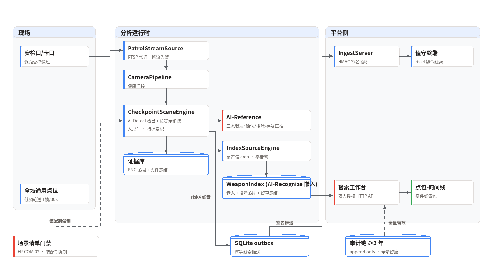

<div align="center">


**持械/管制器具双形态视频监管：卡口实时告警 + 以图搜械检索。合规红线全部代码化。**


<!-- 发布时将 OWNER/REPO 替换为实际仓库路径, 并将 ci.yml 复制到 .github/workflows/ci.yml -->


**[English](README_en.md)** | 简体中文


*图：卡口处理流程（真实管道输出）——刀具商品图经开放词汇检出"匕首 0.95"后，AI-Reference 判读问句对裁决"真械/玩具/存疑"三态，系统只判"器械状物"、管制定性归公安。*

</div>

---

## 1. 背景与挑战

校园、医院、监管场所、大型活动的入口安检，长期依赖金属探测与 X 光法定
手段，人员通道的视觉监督存在四项结构性空白：

| 挑战 | 现状描述 |
|------|---------|
| 通用点位不可行 | 远距/遮挡/小目标下开放词汇检测掉点严重，强行上线的漏报误报都没有业务价值 |
| 玩具/道具混淆 | 玩具刀与真刀、球棒与棍棒是**光学同构**——纯视觉检测原理上判不了"真实性"（87 crop 实测天花板 74%） |
| 高敏数据合规 | 涉枪涉刀数据是最敏感级别：谁能查、查什么、留多久，任何一处失守都是事故 |
| 案后检索缺失 | 案件回溯时"翻三天录像"找一柄刀的出现轨迹——历史视频是不可检索的死资产 |

## 2. 双形态设计（范围先行）

| 形态 | 场景 | 技术路线 |
|------|------|---------|
| ① 卡口实时告警 | 专用安检口/入口卡口（近距受控通过，器械 ≥64px 硬准入） | 开放词汇检测 + 负提示消歧 + 人形门 + 持握累积 + AI-Reference 三态裁决 → risk4 |
| ② 以图搜械检索 | 全域历史视频库（案件驱动） | 低频轮巡检出"手持器械状物"crop 入索引 → 双人授权查询 Top-N + 时间线 |

**范围外声明（第一原则）**：通用监控点位的实时持械检测**不承诺、不建设、
不验收**——配置门禁在装配期强制（清单外点位 `EnablementError`）。
法定安检（金属探测/X 光）是权威手段，本系统是人员通道监督的补充；
**"管制器具"定性由公安依职权认定，系统只判"器械状物"**，告警措辞
一律"疑似持械状物"。

## 3. 三模型流水线

| 模型 | 职责 | 回答的问题 |
| --- | --- | --- |
| AI-Detect（开放词汇检测） | L1 器械检出 | "画面里有刀/棍/斧/匕首状物吗？"（正集 20 词 + 负集 7 词一次编码） |
| AI-Recognize（免提示提议 + 区域嵌入） | L2 检索语义 | "查询图与持物索引里哪条记录是同类器械？它还出现在哪些点位、什么时间？" |
| AI-Reference（Qwen3VL grounding） | 三态裁决 | "这是真金属刀——还是塑料玩具道具？确认 / 排除 / 存疑直推" |

三个模型是流水线，不是三个孤岛：AI-Detect 管召回（负提示消歧压伞/
自拍杆第一误报源），规则引擎（人形门/持握 ≥1s/Gate-0/合法携带白名单）
管"该不该报"——产品图/货架图在真实卡口**永远到不了告警**；
AI-Recognize 的区域嵌入驱动持物索引与以图搜械（点位-时间线线索包）；
"检出了但真伪存疑"的分支交给 AI-Reference 三态裁决——**冷却门前置**
保证判读 ≤1 次/类目/300 秒（服务通道单次 1~3 秒），最终由值守人审
终审，系统不越权定性。

## 4. 技术亮点

- **AI-Reference 三态裁决（FR-COM-04 的可运行实现）**——"是/否"判别问句对 +
  上下文裁决 + 事件主张强度不对称规则：`controlled_item`（最敏感定性
  主张）从严排除，`weapon_carry` 存疑直推不吃召回。双后端可插拔：
  HTTP 服务通道（零本地显存，1~3s）或本地权重加载。
- **消歧 36%→93% 的完整归因链**——对 10 个残余误报逐图人工审计：
  6 张是**金属复制品被搜索词标成"玩具"**（数据集真值错误，连同审计中
  另发现的 1 张共 7 张移入边界目录）、2 张图内印着"儿童玩具刀"、
  2 张为真疑难道具；对应修复：边界样本机制（§8.4 boundary role）+
  整帧文字上下文裁决。每一项都有证据（[CURATION.md](
  ../weapon_guard/tests/real_images_baidu_v2/CURATION.md)）。
- **人形门（FR-CK-02）**——器械检出须与人形框关联（外扩 25%）才进
  持握/告警管线；产品图类误报源在真实卡口被结构性消除。
- **以图搜械检索工程化**——向量矩阵快路：10 万级 P95=19ms、**百万级
  P95=172ms**（SLO ≤5s）；增量落库（脏标记）、90 天留存 + 案件冻结
  豁免；双人授权工作台 HTTP API（自批 403 有测试）。
- **合规红线代码化**——场景清单外点位装配即拒绝 + 审计；审计链
  append-only 落库 ≥3 年；证据 PNG 落盘 ≥1 年 + 案件冻结豁免清理；
  重启不丢索引、不丢审计、不丢证据（"索引即办案资产"）。
- **合法携带消歧**——白名单台账（人员/类目/时段），白名单内零告警
  有专项测试；台账准确性责任在登记方。

## 5. 效果图

以下标注均为真实管道输出（检测框与置信度取自回归数据集 `detections.json`，
未经手工修改）。

五类器械逐一图例（每张含真实检出框、置信度与 SLO 徽标）：

| 刀状物 | 管制刀具（匕首） | 剑/长刀 |
|:---:|:---:|:---:|
|  |  |  |
| **棍状物** | **斧状物** | |
|  |  | |

消歧负样本（正确不报 = 系统的另一半能力）：

| 雨伞 | 拐杖 | 玩具刀（印字） |
|:---:|:---:|:---:|
|  |  |  |

总览：


## 6. 端到端流程示例

以一次卡口通过为例（时间为示意，判定与路由为真实逻辑）：

| 时刻 | 环节 | 说明 |
|------|------|------|
| 09:02:10 | 人员通过 | 安检通道逐人受控通过 |
| 09:02:10.2 | 首帧检出 | 检出"匕首 0.95"，但无人形关联/持握不足 1s，不产候选 |
| 09:02:11 | 持握确认 | 同一空间格+类目持续命中，held_s ≥1s，进入告警候选 |
| 09:02:11.1 | AI-Reference 三态裁决 | 判别问句对："真刀 yes / 玩具 no" → **确认** |
| 09:02:11.2 | risk4 告警 | `asset/controlled_item`（疑似）推送值守终端 ≤3s，证据 crop 落盘 |
| 09:07 | 冷却期内 | 同类目不再重复告警/判读（≤1 次/类目/冷却期） |
| 案后 | 以图搜械 | 办案员双人授权提交器械照片 → Top-N 相似出现记录 → 点位-时间线 |

## 7. 关键指标

基准口径：**220 张百度商品图（内容哈希去重；其中 7 张金属复制品经
逐图审计后真值治理为边界样本）**，图像级检测 + AI-Reference 二段确认
全管线，
详见 [CHANGELOG](../../weapon_guard/CHANGELOG.md)。

**六项 §5.1 数值 SLO 全部达标**：

| 事件 | R (≥0.80) | P (≥0.75) | 消歧 (≥90%) | 结论 |
|------|-----------|-----------|-------------|------|
| asset/weapon_carry | 0.81 | 0.90 | 91% | ✓ 全过 |
| asset/controlled_item | 0.95 | 0.95 | 93% | ✓ 全过 |

| 指标 | 数值 | 口径 |
|------|------|------|
| 优化轨迹 | controlled_item 消歧 36%→93% · P 0.66→0.95；weapon_carry P 0.71→0.90 | 类目修正→真值治理→判读问句 v3/v4 |
| AI-Reference 三态裁决 | 确认 81 / 排除 30 / 存疑直推 33（另 2 例拒答降级直推） | 146 个告警 crop |
| 检索时延 | 10 万级 P95=28ms · **百万级 P95=172ms** | 合成膨胀画廊（单机实测），SLO ≤5s |
| 工程质量 | 76 个单元测试 | 无 GPU 环境全量运行 |
| 证据/审计 | 证据 ≥1 年（案件冻结豁免）· 审计 ≥3 年 | SQLite 落库，重启恢复 |

> **诚实口径**：组件级回归（无人形门、无持握时序的商品图测试），
> 证明能力而非生产验收；检索 Top-10 为类目代理口径（画廊 135）。
> 其余边界与未决项见 §10。

## 8. 快速开始

```python
import cv2
from weapon_guard import categories as wcats
from weapon_guard.detectors import NegativeGuardDetector, checkpoint_backend
from weapon_guard.engine import CheckpointEngineConfig, CheckpointSceneEngine
from weapon_guard.scene import WeaponEngineContext  # 门禁/审计/索引/证据

detector = NegativeGuardDetector(
    backend=checkpoint_backend(  # AI-Detect 权重
        "wedetect_hf_models/wedetect-base",
        device="cuda", score_thr=0.30),
    positives=wcats.checkpoint_prompts()[0],
    negatives=wcats.NEGATIVE_PROMPTS, min_score=0.30,
    pass_through=("人",))            # FR-CK-02 人形门
engine = CheckpointSceneEngine(
    CheckpointEngineConfig(point_id="CK-001", require_person=True),
    detector=detector)

clues = engine.process(cv2.imread("gate_frame.jpg"))  # → risk4 疑似线索
```

```bash
# 真实图片三阶段回归 (检测 → Ref 判读 → 报告)
python -m weapon_guard.real_eval --detect --device cuda
python -m weapon_guard.real_eval --confirm --ref-server http://127.0.0.1:8324/ask
python -m weapon_guard.real_eval --report

# 卡口轮巡服务 (场景备案前置: WeaponStore.save_scene, 否则装配即 EnablementError)
python -m weapon_guard.runner --config weapon_guard/deploy/config.example.json

# 检索工作台 API (双人授权 + 全量审计)
python -m weapon_guard.workbench_server --db /data/weapon.db --port 8302
```

## 9. 系统架构



## 10. 范围与限制

- **真伪/道具判别是 AI-Reference 所依赖的视觉模型的能力边界**：AI-Detect 开放词汇检测的"真刀 vs 玩具刀"
  天花板实测 74%（87 crop），三问裁决仅 64%——消歧达标依赖 AI-Reference 判读
  在环 + 人审终审；正式达标路径是受控摆拍集 Ref stage2 微调（§8.2）。
- **§8.4 零误报准出未过**：残余 FP 8+1（球棒/拐杖光学同构 + AI-Reference 拒答
  降级直推）。数值 SLO 全过 ≠ 验收准出。
- **基准数据为百度商品图（组件级）**：无真人持握、无持握时序、无夜间。
  §8.2 规定的验收基准（道具摆拍 ≥150 次 + 白名单用例 + 案件回溯金标集）
  尚未建设。
- **场景清单制是合规前提**：仅限政府/主管部门主导场景部署；清单外点位
  装配即拒绝（FR-COM-02）。
- **检索金标集未建**：Top-10 ≥80% 目前为类目代理口径，正式验收依赖
  公安合作的案件回溯标注。

## 11. License 与数据声明

代码为商业软件（Commercial Software），未经授权不得复制、修改、分发或
商用。验收集图片来自百度图片搜索，**不随仓库分发**（涉械图片敏感级更高，
公开演示请使用道具摆拍图）；`fetch_v2.py` 提供可复现抓取（标注仅供
研究），`detections.json` / `confirms.json` 与评估报告随仓库提供。
本系统仅在政府/主管部门主导的场景清单内部署（FR-COM-02）；
"管制器具"定性由公安依职权认定。
