<div align="center">


**Dual-form weapon & controlled-item video surveillance: real-time checkpoint alerts + image-search over archived video. Compliance red-lines enforced in code.**


<!-- Replace OWNER/REPO with the actual repo path when publishing, and copy ci.yml to .github/workflows/ci.yml -->


[](https://github.com/hi-agi-lab/AutoVision)
[](https://pypi.org/project/autovision-framework/)

English | **[简体中文](README.md)**

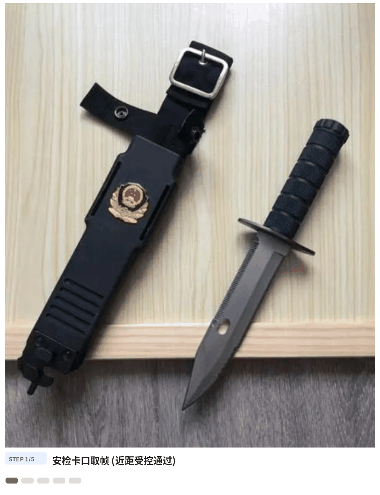

*Figure: checkpoint flow (real pipeline output) — a knife product photo detected as "dagger 0.95" is adjudicated by AI-Reference into one of three states: real weapon / toy / unclear-for-human-review. The system only reports "weapon-like object"; the legal "controlled item" determination belongs to the police.*

</div>

---

## 1. Background & Challenges

Entrance screening at schools, hospitals, correctional facilities and large
events relies on metal detectors and X-ray as the legal authority. Visual
supervision of pedestrian lanes has four structural gaps:

| Challenge | Current state |
|------|---------|
| Generic CCTV is a no-go | Open-vocabulary detection degrades badly at distance/occlusion; forced deployment produces misses and false alarms nobody can act on |
| Toy/prop confusion | Toy knife vs real knife, baseball bat vs club — **optical isomorphism**. Pure visual detection cannot judge "realness" (measured ceiling: 74% on 87 crops) |
| Highly sensitive data | Weapon-related data is the highest sensitivity class: who queries what, retained how long — any slip is an incident |
| Post-case retrieval | Rewinding three days of footage to trace one knife — archived video is a dead, unsearchable asset |

## 2. Dual-Form Design (scope first)

| Form | Scene | Approach |
|------|------|---------|
| ① Checkpoint real-time alerts | Dedicated security lanes (controlled passage, object ≥64px hard gate) | Open-vocab detection + negative-prompt disambiguation + person gate + hold accumulation + AI-Reference 3-state adjudication → risk4 |
| ② Image-search retrieval | Archived video (case-driven) | Low-frequency patrol crops of "held weapon-like objects" into an index → dual-authorization Top-N query + timeline |

**Out-of-scope declaration (first principle)**: real-time weapon detection on
generic CCTV is **not promised, not built, not accepted** — the scene-registry
gate enforces this at assembly time (`EnablementError` for unregistered
points). Metal detectors/X-ray remain the legal screening authority; this
system supplements pedestrian-lane supervision. **The "controlled item"
legal determination belongs to the police** — the system only reports
"weapon-like object", and every alert is worded "suspected weapon-like object".

## 3. Three-Model Pipeline

| Model | Role | Question it answers |
| --- | --- | --- |
| AI-Detect (open vocabulary) | L1 object detection | "Is there a knife/club/axe/dagger-like object?" (20 positive + 7 negative prompts, single encoding) |
| AI-Recognize (prompt-free proposals + region embeddings) | L2 retrieval semantics | "Which index record matches this query image? Where and when did this object appear?" |
| AI-Reference (Qwen3VL grounding) | 3-state adjudication | "Is this a real metal knife — or a plastic toy prop? confirm / reject / unclear-for-human-review" |

The models form a pipeline, not islands: AI-Detect owns recall (negative
prompts kill the umbrella/selfie-stick false-alarm class); the rule engine
(person gate / hold ≥1s / Gate-0 / legal-carry whitelist) owns "should this
alarm at all" — product photos and shelf shots can **never alarm** on a real
checkpoint; AI-Recognize region embeddings power the held-object index and
image search (point-timeline case packages); and the "detected but realness
unclear" branch goes to AI-Reference 3-state adjudication — **cooldown-first
ordering** caps judging at ≤1/class/300s at 1–3s per call (service channel).
Human reviewers make the final call.

## 4. Technical Highlights

- **AI-Reference 3-state adjudication (a working FR-COM-04)** — yes/no discriminative
  prompt pairs + context reading + claim-severity asymmetry rule:
  `controlled_item` (the most legally sensitive claim) is excluded
  conservatively; `weapon_carry` degrades to unclear-for-review instead of
  losing recall. Two pluggable backends: HTTP service (zero local VRAM,
  1–3s) or locally loaded weights.
- **A complete attribution chain for disambiguation 36%→93%** — a per-image
  manual audit of the 10 residual false positives found 6 were **metal
  replicas labeled "toy" by the search query** (dataset truth errors; with 1
  more found in the audit, 7 moved to the boundary set), 2 had "children's
  toy knife" printed in the image, and 2 were genuinely hard props. Fixes:
  boundary-sample role (§8.4) + full-frame text/context adjudication. Every
  jump has evidence
  ([CURATION.md](../../weapon_guard/tests/real_images_baidu_v2/CURATION.md)).
- **Person gate (FR-CK-02)** — a detected object must fall within an expanded
  person box to enter hold/alarm; person-less product photos can never alarm
  on a real checkpoint.
- **Retrieval engineering** — vectorized matrix fast path: 100k-crop P95=19ms,
  **1M-crop P95=172ms** (SLO ≤5s); incremental persistence via dirty sets;
  90-day retention with case-freeze exemption; dual-authorization workbench
  HTTP API (self-approval → 403, tested).
- **Compliance red-lines in code** — unregistered scene points are rejected
  at assembly with audit; append-only audit chain persisted ≥3 years;
  evidence PNGs persisted ≥1 year with case-freeze exemption from TTL
  cleanup; restarts lose no index, no audit, no evidence.
- **Legal-carry disambiguation** — whitelist ledger (subject/category/time
  window); zero alarms inside the whitelist is a dedicated test; ledger
  accuracy is the registrar's responsibility.

## 5. Gallery

All annotations are real pipeline outputs (boxes/scores from the regression
`detections.json`, unmodified).

Five object classes (real detection boxes, confidence, SLO badges):

| Blade | Controlled (dagger) | Sword |
|:---:|:---:|:---:|
| 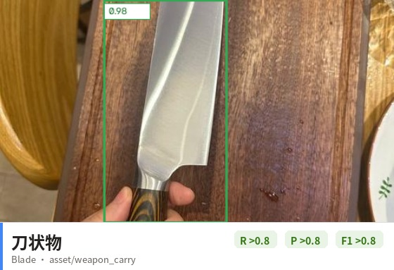 | 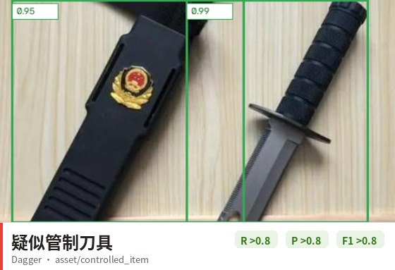 | 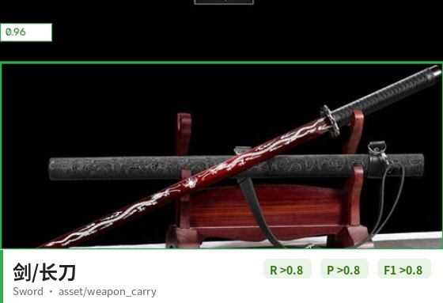 |
| **Club** | **Axe** | |
| 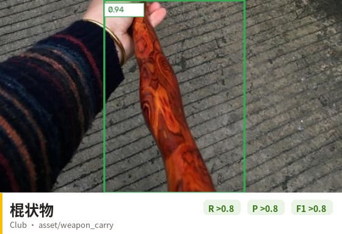 | 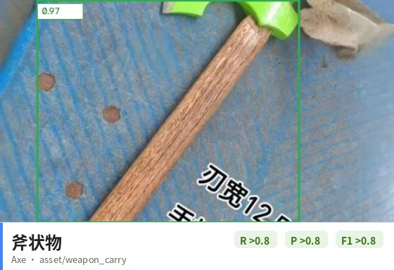 | |

Disambiguation negatives (correctly silent — the other half of the system):

| Umbrella | Cane | Toy knife (labeled) |
|:---:|:---:|:---:|
| 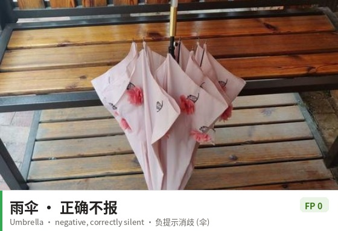 | 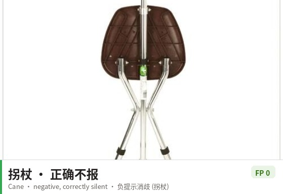 | 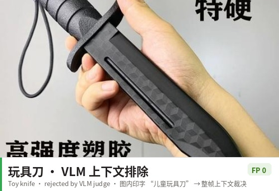 |

Overview:

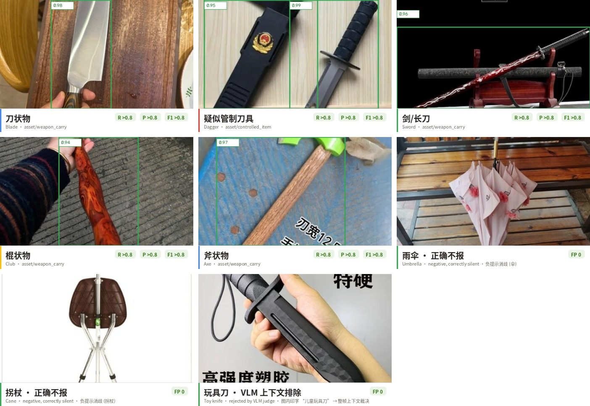

## 6. End-to-End Walkthrough

One passage through a checkpoint (times illustrative; logic real):

| Time | Stage | Notes |
|------|------|------|
| 09:02:10 | Passage | Controlled single-file passage through the lane |
| 09:02:10.2 | First detection | "dagger 0.95" — no person association / hold <1s → no candidate |
| 09:02:11 | Hold confirmed | Same spatial cell + class persists, held_s ≥1s → alarm candidate |
| 09:02:11.1 | AI-Reference 3-state judge | Discriminative pair: "real knife yes / toy no" → **confirmed** |
| 09:02:11.2 | risk4 alert | `asset/controlled_item` (suspected) pushed to guard terminal ≤3s, evidence crop persisted |
| 09:07 | Cooldown | No repeat alarm/judgment for the class within 300s |
| Post-case | Image search | Investigator submits a weapon photo under dual authorization → Top-N appearance records → point-timeline |

## 7. Key Metrics

Benchmark: **220 Baidu product images (content-hash deduplicated; 7 metal
replicas re-labeled as boundary samples after a per-image truth audit)**,
image-level detection + AI-Reference adjudication full pipeline, see
[CHANGELOG](../../weapon_guard/CHANGELOG.md).

**All six §5.1 numeric SLOs met**:

| Event | R (≥0.80) | P (≥0.75) | Disambiguation (≥90%) | Verdict |
|------|-----------|-----------|-------------|------|
| asset/weapon_carry | 0.81 | 0.90 | 91% | ✓ all pass |
| asset/controlled_item | 0.95 | 0.95 | 93% | ✓ all pass |

| Metric | Value | Scope |
|------|------|------|
| Optimization trail | controlled_item disambiguation 36%→93% · P 0.66→0.95; weapon_carry P 0.71→0.90 | category fix → truth curation → judge prompts v3/v4 |
| AI-Reference 3-state verdicts | confirmed 81 / rejected 30 / unclear 33 (2 refusals pushed as unclear) | 146 alarm crops |
| Retrieval latency | 100k crops P95=28ms · **1M crops P95=172ms** | synthetic expansion (single machine), SLO ≤5s |
| Engineering | 76 unit tests | full run without GPU |
| Evidence/audit | evidence ≥1y (case-freeze exempt) · audit ≥3y | SQLite-persisted, restart-safe |

> **Honest scope**: component-level regression (product photos without
> persons, no hold temporal sequence, no night) — capability evidence, not
> production acceptance; retrieval Top-10 uses a category-proxy protocol
> (gallery 135). Remaining limits and open items: see §10.

## 8. Quick Start

```python
import cv2
from weapon_guard import categories as wcats
from weapon_guard.detectors import NegativeGuardDetector, checkpoint_backend
from weapon_guard.engine import CheckpointEngineConfig, CheckpointSceneEngine

detector = NegativeGuardDetector(
    backend=checkpoint_backend(  # AI-Detect weights
    "wedetect_hf_models/wedetect-base",
    device="cuda", score_thr=0.30),
    positives=wcats.checkpoint_prompts()[0],
    negatives=wcats.NEGATIVE_PROMPTS, min_score=0.30,
    pass_through=("人",))            # FR-CK-02 person gate
engine = CheckpointSceneEngine(
    CheckpointEngineConfig(point_id="CK-001", require_person=True),
    detector=detector)

clues = engine.process(cv2.imread("gate_frame.jpg"))  # → risk4 suspected clues
```

```bash
# Three-stage real-image regression (detect → AI-Reference adjudication → report)
python -m weapon_guard.real_eval --detect --device cuda
python -m weapon_guard.real_eval --confirm --ref-server http://127.0.0.1:8324/ask
python -m weapon_guard.real_eval --report

# Checkpoint patrol service (scene filing required first: WeaponStore.save_scene,
# otherwise assembly raises EnablementError)
python -m weapon_guard.runner --config weapon_guard/deploy/config.example.json

# Retrieval workbench API (dual authorization + full audit)
python -m weapon_guard.workbench_server --db /data/weapon.db --port 8302
```

## 9. Architecture

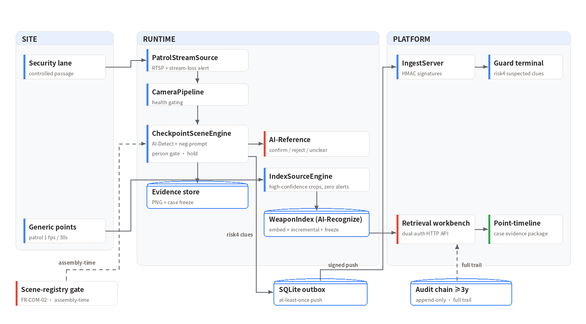

## 10. Scope & Limitations

- **Real-vs-toy is a capability boundary of the models behind AI-Reference**: AI-Detect's open-vocab
  ceiling on "real knife vs toy knife" measures 74% (87 crops); a three-way
  tie-breaker question reaches only 64% — disambiguation at target SLO
  depends on AI-Reference in the loop plus human review. The formal path is
  Ref stage2 fine-tuning on staged prop sets (§8.2).
- **§8.4 zero-FP bar not met**: 8+1 residual FPs. Numeric SLOs passing
  ≠ acceptance sign-off.
- **Benchmark is web product photos (component-level)**: no persons, no hold
  temporal sequence, no night. The §8.2 acceptance basis (≥150 staged prop
  passages + whitelist cases + case-retraced golden set) is not built.
- **Scene-registry is a compliance precondition**: deployment only in
  government/authority-led scene lists; unregistered points are rejected at
  assembly (FR-COM-02).
- **Retrieval golden set not built**: Top-10 ≥80% currently uses a
  category-proxy protocol; formal acceptance requires case-retraced
  annotations with law-enforcement cooperation.

## 11. License & Data Statement

Code is commercial software; copying, modification, distribution or
commercial use without authorization is prohibited. Benchmark images come
from Baidu image search and are **not redistributed** (weapon imagery is
especially sensitive; use staged prop photos for public demos). `fetch_v2.py`
provides reproducible fetching (annotations for research only);
`detections.json` / `confirms.json` and evaluation reports ship with the
repo. Deployment is restricted to authority-led scene lists (FR-COM-02);
the "controlled item" legal determination belongs to the police.

---

The detection backbone, streaming inference runtime, and export chain of this solution are provided by the open-source framework [AutoVision](https://github.com/hi-agi-lab/AutoVision) (`pip install autovision-framework`); see the [integration design](https://hi-agi-lab.github.io/AutoVision/ecosystem/) for details.
